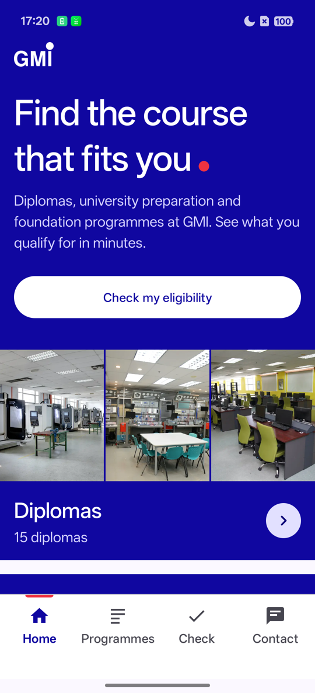
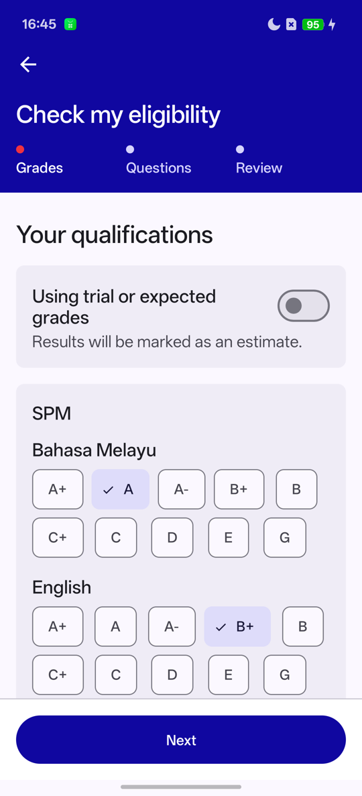
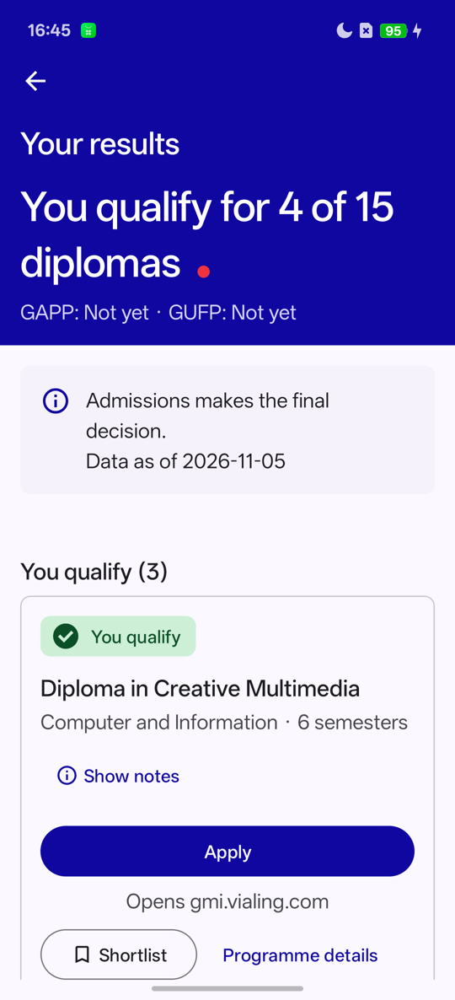

# GMI Prospect App

An offline Android app that helps prospective students of the German-Malaysian Institute (GMI) find a programme, check whether they qualify, and send an enquiry. I built it solo as a course mini project (SPG0562) in November 2026.

This repository is a showcase. The source code is kept private; I am happy to walk through it on request.

> Not an official GMI product. It is a student project. Programme data comes from GMI's public website and programme guide, and was a snapshot as of November 2026. Always confirm with GMI Admissions.

  
  
  

## What it does

- Browse all 21 GMI programmes and pathways (15 diplomas, GAPP, GUFP and four other pathways) with fees, intakes and entry standards.
- Check eligibility in three steps (grades, questions, review). Results are grouped and you can shortlist up to three programmes.
- Compare programmes side by side, follow a document checklist, and read the financial aid and after-offer timeline.
- Send an enquiry through your own email app, behind a PDPA consent notice.
- English and Bahasa Malaysia, light and dark themes, animated and branded UI that respects reduced motion.

## How it is built

- Native Android in Java 17 and XML (min SDK 26, target SDK 36), built with Gradle.
- A separate, pure Java eligibility engine module with no Android dependency, so the rules can be tested and reused on their own.
- All programme data ships inside the app as one versioned JSON file. There is no backend.
- Release builds use R8 shrinking and signing through environment variables. A separate evaluation build adds a watermark and an expiry date.

## Privacy and security

- No INTERNET permission. The app cannot reach the network, and a unit test checks the merged release manifest.
- No personal data is stored. Only the language and theme choice and saved programme IDs stay on the phone. Grades and enquiry text are held in memory only.
- Enquiry text goes only to the user's own email app.
- Gitleaks over the full git history found no leaked secrets. A MobSF static scan found no trackers and no hardcoded secrets.

## Testing

- 534 JVM unit tests pass (430 in the engine, 104 in the app), checked on 24 November 2026.
- A separate on-device test suite ran on physical Android phones. No emulator.
- Lint reports no errors. Accessibility work covers content descriptions, 200 percent font scale and colour contrast checks.

## Status

Presented on 17 November 2026. On 18 November an evaluation build was sent to my lecturer to show GMI management. It has not been adopted and I do not know the outcome. No users, no deployment.

## Contact

Muhammad Adam bin Afzainizam, via [GitHub](https://github.com/adamafzainizam).
